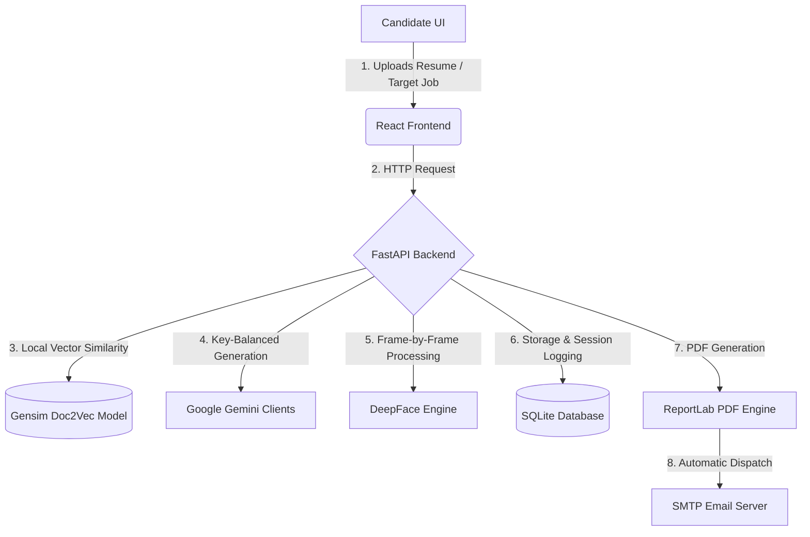

# Speak2HR 🚀
### AI-Powered Interview Assessment & Mock Platform

Speak2HR is an advanced, enterprise-grade AI-powered interview platform designed to modernize recruitment and skill assessment. Bridging the gap between traditional evaluation techniques and modern artificial intelligence, Speak2HR offers a **progressive 8-level mock interview system** packed with real-time video, audio, and facial emotion analysis.

---

## 🎯 System Architecture

The project consists of three core components:
1. **Frontend (React.js)**: A responsive single-page web app built with Material UI (MUI) featuring intuitive candidate & HR dashboards, live WebRTC-based peer interview capability, interactive webcam interface, and advanced data visualization charts.
2. **Backend (FastAPI)**: A Python FastAPI application providing low-latency REST endpoints and WebSocket signaling.
3. **ML & AI Engine**: Integrated with **Google Gemini 2.0 Flash** for parallel-processed natural language evaluation, **DeepFace** for real-time engagement and emotion extraction, and **Doc2Vec** (Gensim) for resume-to-job matching.



---

## ✨ Features

### For Candidates
*   **Progressive AI Interviews**: Journey through 8 distinct stages, from basic introductory HR questions up to complex coding/algorithmic tasks and system design assessments.
*   **Multimodal Evaluation**: Analyzes facial video frames (for emotional engagement) and audio recordings (for transcription clarity, accuracy, and keyword presence).
*   **Daily Assessments**: Seed-based, algorithmically randomized daily testing consisting of MCQs, short answers, and scenario questions.
*   **Detailed Analytics & PDF Reports**: Receive instant breakdown feedback after each level and download clean, professional PDF reports outlining performance metrics.
*   **Live HR Slot Booking**: View HR availability and schedule directly inside the platform.

### For HR Professionals
*   **Centralized HR Dashboard**: Manage candidate profiles, check matching similarity scores, and review dynamic AI-interview histories.
*   **Evaluation Interface**: Score candidate live interview sessions and append customized feedback notes.
*   **Live Slot & Calendar Management**: Open and modify booking slots for personal interviews.

---

## 🚀 Tech Stack

| Component | Technology | Purpose |
| :--- | :--- | :--- |
| **Frontend** | React 18, Material UI (MUI), React Router v6 | UI Layout, components, routing |
| **State Management** | Zustand | Light-weight client state persistence |
| **Webcam & Audio** | React Webcam | Media capture and streaming |
| **Visual Charts** | Chart.js, React-Chartjs-2 | Metric & historical score graphing |
| **Backend Framework** | FastAPI (Python 3.8+) | API endpoints & high-concurrency routing |
| **Signaling** | WebSocket | WebRTC signaling for peer-to-peer interviews |
| **AI LLM Engine** | Google Gemini 2.0 Flash | Question generation, transcription & answer grading |
| **Emotion Analysis** | DeepFace (OpenCV backend) | Facial frame emotion and stress analysis |
| **Resume Matching** | Gensim Doc2Vec | Resume-to-Job Description vector matching |
| **Database** | SQLite (with SQLAlchemy / raw sqlite3) | Local user data, sessions, and bookings |
| **Reporting & Mail**| ReportLab, SMTP | Dynamic PDF generation and email dispatch |

---

## 📁 Project Structure

```text
Speak2HR/
├── ML/                          # FastAPI Backend & ML Models
│   ├── main.py                  # Main API service entry point
│   ├── database.py              # SQLite schema & database connection management
│   ├── question_bank_manager.py # Question caching and template mapping
│   ├── cv_job_maching.model     # Pre-trained Doc2Vec model file
│   ├── .env.example             # Configuration template for ML backend
│   ├── requirements.txt         # Python library dependencies
│   └── (directories for temporary recordings, profiles, reports, assessments)
├── frontend/                    # React Web Application
│   ├── src/
│   │   ├── components/          # Reusable layout and custom UI components
│   │   ├── pages/               # Candidate & HR pages (Dashboards, Interviews, Reports)
│   │   ├── services/            # Axios API client services
│   │   └── store/               # Zustand auth & application store
│   ├── package.json             # NPM dependencies & scripts
│   └── .env.example             # Frontend environment variables template
├── run_locally.bat              # Automated Windows setup & runner script
├── HOW_TO_RUN.md                # Quick-start reproducibility guide
└── README.md                    # Root Documentation (this file)
```

---

## 🛠️ Installation & Setup

You can run the full system using the automated batch runner on Windows or configure the components manually.

### Prerequisites
*   **Python 3.8+** installed and added to path.
*   **Node.js 16+** and **npm** installed.
*   **5 Google Gemini API keys** (for parallel load-balancing). Get them at [Google AI Studio](https://aistudio.google.com/).

---

### Method A: Automated Run (Windows)

1. Double-click the **`run_locally.bat`** script in the project root.
2. The script will automatically:
    *   Create a virtual environment (`venv`) inside the `ML` directory.
    *   Install backend dependencies from `ML/requirements.txt`.
    *   Copy `.env.example` configurations.
    *   Install frontend node modules from `frontend/package.json`.
    *   Launch both development servers concurrently in new console windows.
3. Open `ML/.env` and insert your Gemini API keys (see [Environment Variables](#-environment-variables)).
4. Access the apps:
    *   **Frontend**: [http://localhost:3000](http://localhost:3000)
    *   **Backend**: [http://localhost:8000](http://localhost:8000)

---

### Method B: Manual Configuration

#### 1. Backend Setup
```bash
cd ML

# Create and activate virtual environment
python -m venv venv
# On Windows:
venv\Scripts\activate
# On Linux/macOS:
source venv/bin/activate

# Install dependencies
pip install -r requirements.txt

# Create config
cp .env.example .env

# Run FastAPI Server
python main.py
```
The API documentation will be available at [http://localhost:8000/docs](http://localhost:8000/docs).

#### 2. Frontend Setup
```bash
cd frontend

# Install Node packages
npm install

# Create config
cp .env.example .env

# Run React Server
npm start
```
Your browser will open [http://localhost:3000](http://localhost:3000) automatically.

---

## 🔑 Environment Variables

### Backend (`ML/.env`)
Ensure you provide 5 Gemini API keys to balance high-throughput evaluation calls:
```env
GOOGLE_API_KEY_1=AIzaSy... # Key 1: Primary (HR Basic Levels 1-3)
GOOGLE_API_KEY_2=AIzaSy... # Key 2: Secondary (Tech Levels 4-8)
GOOGLE_API_KEY_3=AIzaSy... # Key 3: Tertiary (Transcription & audio feedback)
GOOGLE_API_KEY_4=AIzaSy... # Key 4: Assessment (Daily unique generator)
GOOGLE_API_KEY_5=AIzaSy... # Key 5: Emotion (Parallel video evaluation)

EMAIL_USER=your_email@gmail.com
EMAIL_PASSWORD=your_app_specific_password  # Use Google App Passwords for Gmail
GEMINI_MODEL=gemini-2.0-flash
MONGO_URI=mongodb://localhost:27017/speak2hr   # Fallback database connection string
```

### Frontend (`frontend/.env`)
```env
REACT_APP_API_URL=http://localhost:8000
REACT_APP_NAME=Speak2HR
REACT_APP_VERSION=3.0.0
```

---

## 🧠 ML Mechanics & Scoring Logic

### 1. Progressive Question System
The interview increases in complexity level-by-level, adapting weights dynamically:

| Level | Level Name | Question Type | Target Category | Weight |
| :--- | :--- | :--- | :--- | :--- |
| **1** | Introduction | General | Behavioral | `0.8` |
| **2** | Recent Project | Project Architecture | Technical | `1.0` |
| **3** | Technical Concepts| Foundational OOP / CS | Technical | `1.1` |
| **4** | Coding/Algorithms | Code structures & optimization | Technical | `1.3` |
| **5** | System Design | Scalability & Microservices | Technical | `1.4` |
| **6** | Behavioral | STAR Situation / Task | Behavioral | `1.1` |
| **7** | Scenario Analysis | Practical Problem Solving | Technical | `1.5` |
| **8** | Career Goals | Vision & Culture fit | Behavioral | `0.8` |

### 2. DeepFace Engagement Engine
Captures 2 frames per second (FPS) and parses 7 facial emotions (happy, sad, angry, fear, surprise, disgust, neutral).
$$\text{Engagement Score} = (\text{Positive} \times 1.0) + (\text{Neutral} \times 0.5) - (\text{Negative} \times 0.3)$$
*   **Positive emotions**: Happy, Surprise.
*   **Negative emotions**: Sad, Angry, Fear, Disgust.
*   **Stress Indicators**: Triggers when negative emotions surpass threshold values for consecutive frame intervals.

### 3. Multi-Dimensional Score Algorithm
Each level evaluation uses Gemini & DeepFace inputs to form a **Base Score** (0-1.0):
$$\text{Base Score} = (\text{Relevance} \times 0.25) + (\text{Clarity} \times 0.20) + (\text{Confidence} \times 0.15) + (\text{Tech Accuracy} \times 0.20) + (\text{Keyword Usage} \times 0.10) + (\text{Emotion Score} \times 0.10)$$

$$\text{Final Weighted Score} = \text{Base Score} \times \text{Level Weight}$$

### 4. Final Rating Scale
*   🏆 **Excellent**: $\ge 85\%$
*   🌟 **Good**: $75\% - 84\%$
*   📈 **Average**: $60\% - 74\%$
*   ⚠️ **Needs Improvement**: $< 60\%$

---

## 📡 Essential API Routes

*   `POST /api/resume/upload` - Extract skills & summarize uploaded resumes.
*   `POST /api/interview/generate-questions` - Generates the personalized 8-level interview pipeline.
*   `POST /api/interview/evaluate-response` - Accepts multipart form data (video/audio recording files) for real-time analysis.
*   `GET /api/interview/session/{session_id}` - Provides session summary statistics.
*   `POST /api/interview/generate-report` - Creates and emails the ReportLab PDF evaluation sheet.
*   `POST /api/assessment/generate` - Fetch randomized daily MCQ/AI grading exercises.

---

## 🔒 Security & Optimization Guidelines
*   **Local Cleanup**: Temporary audio/video segments are programmatically wiped clean immediately following analysis execution.
*   **Rate Limits**: Configured parallel client load-balancing prevents API quota depletion.
*   **Mock Credentials**:
    *   *Candidate*: Any standard email address (e.g., `candidate@test.com`)
    *   *HR*: Any email prefixed with `hr@` or containing `hr` domain mapping (e.g., `hr@company.com`)

---

## 🐛 Troubleshooting

*   **Camera/Microphone Permission Blocked**: Check browser site settings to allow access. Ensure no background programs are occupying your hardware inputs.
*   **DeepFace Model Download Hangs**: DeepFace downloads weights (approx. 500MB) on the first execution. Verify network speed or pre-download using:
    ```python
    from deepface import DeepFace; DeepFace.build_model('Emotion')
    ```
*   **Gmail Authentication Refused**: Enable Google App Passwords instead of entering your personal account password.
*   **Doc2Vec Matching Fails**: Ensure `cv_job_maching.model` is present inside the `ML/` directory.

---
*Created and maintained by the Speak2HR Development Team.*

